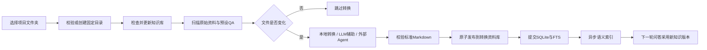

# QAing 项目资料库（概念版）

> 版本：D12 Concept v1.0
> 日期：2026-08-12
> 状态：用户已确认，可进入落地设计与开发
> 关联：`docs/PRD-QAing-项目资料库-落地版.md`

## 1. 用户真正需要解决的问题

用户不是要一个“批量上传文件”的入口，而是要把 QAing 的资料能力升级成一套**按项目长期维护的本地知识生产线**：

1. 每个客户、品牌、路演或会议对应一个独立项目目录。
2. 用户只负责把原始资料放进项目；QAing 负责发现变化、转换、校验、索引和持续更新。
3. 原始文件可以很多、格式不一，但只有经过验证的标准 Markdown 才能成为检索事实源。
4. 新增或修改一个文件时，只处理变化文件，不重复转换整个项目。
5. 用户能够直接看到转换结果、携带项目，也能知道哪些内容已可用、哪些仍需处理。
6. 预设 QA 是高信任直答内容，必须和普通品牌/产品资料严格隔离，不能由普通文档自动“猜”出来。

## 2. 冻结方案

选择“**显式项目根 + 固定输入区 + 项目内可见的转换资料库 + SQLite 增量清单 + 隔离转换流水线**”。

不扫描整个项目根目录，不把任意现有文件夹都当资料，不允许外部 Agent 直接写 QAing 数据库，也不让转换产物再次进入输入扫描。

### 2.1 目录结构

```text
项目文件夹/
├── 原始资料/                 # 普通资料的唯一输入根
│   ├── 品牌/                 # 可选的人类分组，不是硬分类
│   ├── 产品/                 # 可选的人类分组，不是硬分类
│   └── 通用/                 # 可选的人类分组，不是硬分类
├── 预设QA/                   # 已审核直答内容的唯一输入根
├── 转换资料库/               # QAing 生成或用户手动放入的标准 Markdown
│   ├── 资料/                 # 镜像“原始资料”的相对目录
│   └── 预设QA/               # 通过严格解析与确认的 QA
└── .qaing/
    └── project.json          # 仅项目 UUID 与目录协议版本
```

### 2.2 为什么只把预设 QA 单独分开

- “品牌/产品/通用”经常互相混合，适合作为可选目录提示，不适合作为硬语义。
- “预设 QA”会进入最快、最高优先级的直答链路，错误提升会直接造成高置信误答，因此必须物理隔离并经过严格预览确认。
- 检索时仍可从来源、目录提示和正文实体判断品牌或产品，无需为每类建立互斥数据库。

## 3. 用户流程



关键体验：

- 首次选择项目时解释三个目录的用途，经用户确认后一键创建缺失目录。
- “同步”按钮统一命名为“检查并更新知识库”，避免误解为双向云同步。
- 启动、手动点击和目录事件都走同一条增量核对流程；目录事件只作提醒，完整扫描才是正确性来源。
- 实时会话中禁止切换项目；当前问答轮固定使用启动时的知识版本，新版本从下一轮生效。

## 4. 增量同步语义

- 同路径、同内容哈希：零转换、零分块、零 embedding。
- 同路径、内容变化：只创建新修订；上一版保持可用，直到新版本完整验证并原子切换。
- 唯一匹配的重命名：更新路径，不重新转换和嵌入。
- 同内容多路径：保留两个来源关联，但共享标准文档与索引内容。
- 删除：只有项目根可读且完整扫描成功后才进入缺失状态；第二次完整扫描仍缺失或用户确认后才停用。
- 根目录不可访问、权限撤销、磁盘离线或扫描取消：不得推断为“大量删除”。
- 转换失败：继续使用上一次成功版本，并明确显示失败项。

## 5. 转换方式

### 5.1 本地确定性转换（默认）

MVP 直接支持 `txt/md/markdown/json/csv/tsv`；后续逐格式加入文本型 PDF、DOCX、PPTX、XLSX、RTF、HTML。转换器在隔离子进程执行，不持有数据库、密钥或任意项目路径权限。

### 5.2 LLM 辅助转换（项目级显式开启）

- 先由本地转换器抽取文本，模型不直接接收任意二进制。
- 项目级显式授权，默认关闭；展示调用成本与文件范围。
- LLM 输出必须经过同一 Markdown 结构、来源覆盖、大小与安全校验。
- 普通资料不得因 LLM 判断而自动升级成预设 QA。

### 5.3 外部 Agent 交接

QAing 导出一个有界任务包（文件标识、输入哈希、格式规范、校验码），用户在其他 Agent 处理后导入结果。导入时重新核对原件哈希、输出格式和大小；外部 Agent 不直接获得项目目录或数据库写权限。

### 5.4 手动转换

用户可把符合规范的 Markdown 手动放入“转换资料库”。通过校验后显示黄色“手动转换已就绪”。QAing 自动生成且未被修改、与原始资料哈希一致时显示绿色“自动转换已就绪”。

## 6. 标准 Markdown

```yaml
---
qaing_schema: qaing-converted/v1
content_kind: source_document
source_id: 00000000-0000-0000-0000-000000000000
source_relative_path: 原始资料/产品/示例.docx
source_sha256: <64位SHA-256>
conversion_mode: local
converter_id: qaing-docx
converter_version: 1.0.0
---
```

正文要求：UTF-8、NFC、LF；一个 H1；按页/幻灯片/工作表使用 H2/H3 锚点；尽量保留原文顺序、表格、列表和事实；摘要不能替代正文；不含脚本、远程资源、宏或可执行附件；无法确认的内容明确标注转换警告。

预设 QA 沿用严格格式：

```markdown
## 问题：非空问题
### 答案
非空答案
```

只有来自“预设QA”输入根、解析成功、冲突检查通过且用户确认的内容，才能进入预设 QA 直答库。

## 7. 前台状态

项目卡常驻左栏，同步中心以右侧 Drawer（窄屏 Sheet）打开，不挤占实时问答与右侧答案工作台。

| 灯色 | 含义 |
|---|---|
| 灰 | 尚未选择项目或从未检查 |
| 红 | 项目目录不可访问、越界/冲突、没有可用知识版本或一致性校验失败 |
| 黄 | 手动转换已就绪、正在扫描/转换、发现待处理变化、等待授权/外部 Agent，或部分失败但仍沿用上次成功版本 |
| 绿 | 所有支持的源文件均由 QAing 自动转换并验证，当前 SQLite/FTS 与源哈希一致 |

灯色必须同时显示图标、文字与检查时间，不能只靠颜色表达。语义索引另设独立标识：

- `关键词可用 · 语义索引中`
- `语义检索已就绪`

## 8. 产品边界

“任何文件”在本期的真实承诺是：授权输入根内的每个常规文件都会被发现并显示明确状态；不承诺任意二进制都能被理解。

本期不自动处理：加密文件、压缩包递归、可执行文件、数据库、宏、symlink、FIFO/device/socket、超限文件。扫描 PDF/图片 OCR、音视频转写是后续能力。

## 9. 成功标准

1. 1000 个未变化文件的第二次扫描：0 转换、0 分块、0 embedding。
2. 只修改一个文件：只产生一个新修订，旧知识持续可用直至原子切换。
3. 重命名：0 重转；重复哈希歧义必须提示用户，禁止猜测。
4. 转换资料库与 `.qaing` 永不进入原始扫描。
5. 项目根离线或权限撤销：0 自动删除，仍可使用上次成功知识版本。
6. 普通资料永不自动进入预设 QA 直答链路。
7. 任一转换、文件发布或数据库事务崩溃点，重启后都可根据哈希幂等收敛。
8. 日志、诊断包和外部 Agent 包不包含资料正文、绝对路径或凭据。
