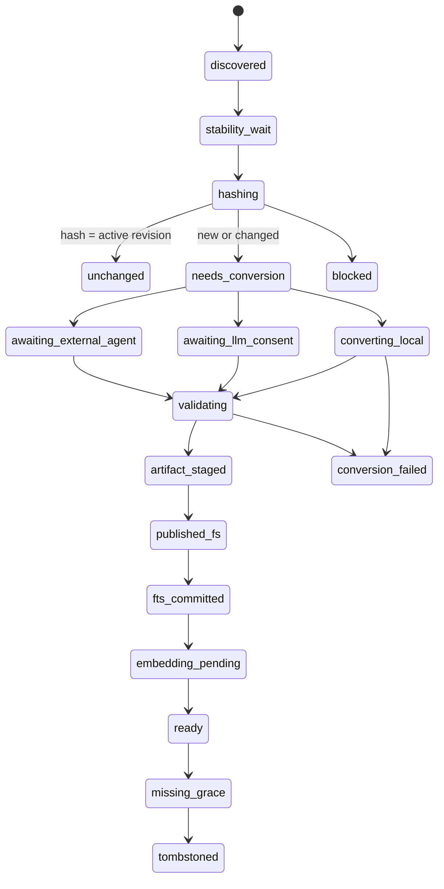

# QAing 项目资料库（落地版）

> 版本：D12 v1.0
> 日期：2026-08-12
> 状态：用户已确认，工程范围冻结
> 上游概念：`docs/PRD-QAing-项目资料库-概念版.md`

## 1. 产品概述

### 1.1 背景

现有 QAing 资料库以文件选择和一次性导入为主，用户需要主动判断文件类型、导入入口与索引状态。真实项目会持续新增、修改、移动和删除资料，也会混合品牌、产品、项目说明与已审核 QA。一次性上传无法提供来源追踪、增量更新、失败恢复和项目隔离。

D12 将资料库升级为“项目知识生产线”：用户选择一个项目文件夹，QAing 只扫描固定输入区，把变化文件转换成可见、可审计的标准 Markdown，并只从转换资料库发布到本地知识库。

### 1.2 目标

- 一个项目对应一个项目根、一个稳定项目 UUID 和一条独立知识版本线。
- 新增/修改/重命名/删除均可增量核对；未变化文件不重复处理。
- 只有校验通过的标准 Markdown 能进入 SQLite/FTS/向量索引。
- 预设 QA 与普通资料物理隔离，保持 QA 优先瀑布检索的高置信边界。
- 文件系统与 SQLite 在崩溃、取消、权限丢失和磁盘异常下可重放收敛。
- 前台清晰显示项目可用性、转换来源、待处理项与语义索引状态。

### 1.3 非目标

- 不承诺理解任意二进制文件。
- 不做云端项目同步、多人协作或跨设备冲突合并。
- 不允许外部 Agent 直接写项目目录、SQLite 或索引。
- 不在 MVP 内做 OCR、图片理解、音视频 ASR、压缩包递归、宏或代码执行。
- 不把项目根全部文件自动视为知识输入。
- 不在首期提供转换 Markdown 的双向编辑同步。

## 2. 角色与核心场景

| 角色 | 主要目标 |
|---|---|
| 项目使用者 | 选择项目、放入资料、点击更新、在会议中使用最新稳定知识版本 |
| 资料管理员 | 查看变化、解决冲突、确认预设 QA、选择本地/LLM/外部 Agent 转换方式 |
| QAing 运行时 | 安全扫描、增量转换、校验、发布、索引和故障恢复 |

核心场景：

1. 首次打开已有项目并创建固定目录。
2. 首次批量转换支持文件，未知格式进入明确的“需处理”状态。
3. 后续新增一份产品资料，仅转换该文件。
4. 修改原文件时继续使用 last-good，待新版校验后原子切换。
5. 手动放入合规 Markdown，显示黄色手动就绪。
6. 导入已审核 QA，经预览确认后进入直答库。
7. 项目目录移动或权限撤销时重新定位，不误删知识。
8. 通过任务包交给外部 Agent，导回后验证并发布。

## 3. 信息架构与目录协议

### 3.1 固定目录

```text
ProjectRoot/
├── 原始资料/**
├── 预设QA/**
├── 转换资料库/
│   ├── 资料/**
│   └── 预设QA/**
└── .qaing/project.json
```

约束：

- 普通资料扫描入口只有 `原始资料/**`。
- 已审核 QA 扫描入口只有 `预设QA/**`。
- `转换资料库/**`、`.qaing/**`、`.git/**`、`node_modules/**`、隐藏项、临时项、锁文件与 macOS bundle 永久排除。
- 缺少固定目录时展示创建预览，用户确认后创建；不得静默把相似目录猜成输入根。
- `project.json` 仅允许：`schemaVersion`、`projectId`、`createdAt`。不存正文、根绝对路径、密钥或转换状态。
- SQLite 是 manifest 与任务状态的唯一事实源。

### 3.2 转换产物命名

普通资料：

```text
转换资料库/资料/<原相对目录>/<原文件名>.<原扩展>--<sourceId前8位>.md
```

预设 QA：

```text
转换资料库/预设QA/<原相对目录>/<原文件名>.<原扩展>--<sourceId前8位>.md
```

同名不同扩展、同 stem、大小写差异不能覆盖。最终路径必须由主进程根据数据库记录生成，转换器和 LLM 不能提供任意目标路径。

## 4. 端到端流程



### 4.1 正确性流程

1. 用户选择目录，主进程获得显式用户同意并解析 canonical root identity。
2. 读取或创建 `.qaing/project.json`，处理重复 UUID 的“移动/复制”选择。
3. 创建 scan generation；旧 generation 的晚到结果不得发布。
4. 只扫描两个输入根；目录事件仅触发“需要核对”，不直接改变数据库。
5. 对常规文件执行 quick probe（size、mtimeNs、dev/inode），首次或变化时用同一个 fd 流式 SHA-256；读取前后 `fstat` 不一致则进入稳定等待并有界重试。
6. 根据 raw hash、检测类型、转换器版本、schema、配置/模型指纹计算缓存键。
7. 未变化跳过；变化文件进入转换任务。
8. 输出写入同目录临时文件，`fsync(file) → validate → rename → fsync(dir)`。
9. SQLite immediate transaction 关联 artifact、导入 document/QA、提交 FTS outbox、切换 active revision。
10. embedding 异步进行；FTS 提交后即可显示“关键词可用”。

### 4.2 FS/SQLite Saga

文件系统与 SQLite 不是跨资源 ACID，任务状态冻结为：

```text
PREPARED → STAGED → PUBLISHED_FS → COMMITTED
                    ↘ FAILED / CANCELLED
```

- `PREPARED`：数据库记录输入哈希、临时/最终相对路径和 operationId。
- `STAGED`：临时产物已写入并校验，记录输出哈希。
- `PUBLISHED_FS`：原子 rename 已完成。
- `COMMITTED`：文档/QA、FTS、关联与 active revision 已在同一事务切换。
- 启动恢复按 operationId、输入哈希、输出哈希和目标路径补交或回滚；不得依赖临时内存状态。
- 任一失败不得撤掉 last-good 知识版本。

## 5. 功能需求

### F1 项目选择与项目身份

**入口**：左栏“项目资料库”卡片或同步中心项目选择器。

**主流程**：

1. 点击“选择项目文件夹”。
2. 原生目录选择器仅允许目录。
3. 校验目录可达、不是应用包、不是输入根的子目录、不是已打开项目的嵌套冲突。
4. 若无固定目录，展示将创建的目录和用途；用户确认后创建。
5. 若无 `project.json`，生成 UUID；若 UUID 已属于另一 canonical root，要求用户选择“这是移动后的同一项目”或“这是复制的新项目”。
6. 保存项目记录，执行首次核对。

**异常**：

- 目录不可访问：红色 `PROJECT_ROOT_UNAVAILABLE`，保留上次成功知识版本。
- 根身份变化：红色 `PROJECT_ROOT_IDENTITY_CHANGED`，禁止自动扫描和删除。
- 项目正在会话中使用：切换按钮禁用，文案“会话结束后可切换项目”。

### F2 安全扫描与增量清单

**范围**：只扫描固定输入根。

**文件约束**：

- 默认上限：深度 12、2000 个文件、单文件 50 MiB、项目探测总量 2 GiB、单次扫描 30 秒，可取消。
- 不跟随 symlink；目录和最终文件 realpath 必须在授权根内。
- 只读取 regular file；FIFO、device、socket、bundle、archive、可执行、数据库、锁文件进入明确阻断或忽略状态。
- 输入哈希必须在同一 fd 上完成，读取前后 stat 变化则不提交。

**增量规则**：

| 观察结果 | 行为 |
|---|---|
| 同路径同 hash | unchanged，不写文档与索引 |
| 同路径新 hash | 创建 revision，保留 last-good |
| 旧路径消失 + 唯一新路径同 hash/type | rename，零重转 |
| 多个 rename 候选 | `RENAME_AMBIGUOUS`，用户确认 |
| 同 hash 多路径 | 多来源关联共享 canonical document |
| 首次缺失 | `missing_grace` |
| 第二次完整扫描仍缺失/用户确认 | tombstone 并停用关联 |
| 根不可达/扫描取消 | 不处理缺失 |

### F3 转换调度

**策略**：项目级三档。

1. `manual`：仅点击按钮检查和转换。
2. `auto_check_confirm`：自动检查，应用前确认；默认。
3. `auto_check_apply`：自动检查并应用支持的安全变化；大量删除和 QA 冲突仍必须确认。

**转换方式**：

- `local`：默认，隔离 converter child，并发 2。
- `llm`：项目级显式 opt-in，并发 1，单文件 120 秒，最多重试 1 次；只接收本地抽取文本。
- `external`：导出任务包，等待用户导回结果。
- `manual`：用户放入合规产物并由 QAing 校验。

**取消**：停止待处理项和活动子进程；已原子发布的文件保留。文案：“已取消，本次已完成 N 项”。

**子进程边界**：只获得单个输入能力和 staging 能力；无数据库、凭据和任意路径；超时执行 SIGTERM，期限后 SIGKILL；畸形/超大输出 fail-closed。

### F4 标准 Markdown 与验证

#### F4.1 文档产物

- UTF-8、NFC、LF；最大 10 MiB。
- 受控 frontmatter 字段必须由 QAing 注入，模型不能覆盖 provenance。
- 单 H1；页/幻灯片/工作表建立稳定锚点。
- 尽量保留正文、表格、列表、数据单位、日期和来源顺序。
- 不允许 script、iframe、远程资源、宏、可执行附件或绝对路径。
- 摘要不可替代正文；不确定内容进入 warnings。

#### F4.2 QA 产物

- 只接受现有严格 Markdown A/B/C grammar、JSON、CSV、TSV。
- 同问同答幂等；同问异答整批拒绝，旧 QA 不变。
- 来自 LLM 或外部 Agent 的 QA 状态为 `needs_review`，用户预览确认后才进入 preset direct route。
- 普通资料中识别出的问答只能作为普通文档内容或待审核建议，不自动升级。

#### F4.3 产物手改

App 生成产物的哈希与 manifest 不一致时：

- 状态 `GENERATED_OUTPUT_MODIFIED`，红色阻断；
- 不覆盖、不自动索引；
- 操作：恢复自动版本 / 重新生成 / 复制到原始资料后作为新输入。

### F5 发布与知识版本

- 只有 canonical converted content 进入 SQLite/FTS/embedding；原始二进制和原始正文不直接写知识库。
- `documents` 继续作为内容事实源；新增 source/artifact association 支持多路径同内容和引用计数。
- FTS 事务成功即产生新的 project knowledge version；embedding 状态独立。
- QA round 开始时绑定 `projectId + knowledgeVersion`，该轮不热切换；下一轮采用新版本。
- 活跃会话期间允许后台转换，但项目切换禁用；若本期检索层不能版本 pin，则延迟发布到 idle，不能混用半轮知识。

### F6 同步中心与状态卡

#### F6.1 左栏项目卡

字段：

- 项目名称和项目选择器；
- 可用性灯、状态文字、上次完整检查时间；
- 当前知识版本；
- `检查并更新知识库`；
- 同步策略入口；
- 独立索引 badge。

灯色：

| 状态 | 文案示例 |
|---|---|
| gray | 尚未选择项目 |
| green | 已同步 · 12:43 检查 |
| yellow | 发现 8 项变化 |
| yellow | 手动转换已就绪 |
| yellow | 已应用可用内容，3 项失败并沿用上次版本 |
| red | 项目目录不可访问 |
| red | 没有可用知识版本 |
| red | 一致性校验失败，更新未应用 |

#### F6.2 同步中心

桌面以右侧 Drawer 打开，窄于 1120px 使用 Sheet；与答案工作台、设置和其他 Drawer 互斥。

布局：

1. 项目选择器、状态、关闭按钮。
2. 阶段：扫描 → 核对 → 转换 → 索引 → 安全应用。
3. 摘要：新增 / 变更 / 删除 / 待 Agent / 失败。
4. 筛选：全部 / 需操作 / 失败。
5. 文件任务列表：相对路径、来源类型、转换方式、状态、last-good。
6. 底部操作：取消本次、重试失败项、导出诊断摘要。

可访问性：

- 颜色不单独传义；状态必须有图标和文字。
- 项目选择器有可见 label；关键按钮触点至少 44px。
- 阶段变化 `aria-live=polite`，逐文件高频更新不播报；UI 更新上限 2Hz。
- Drawer/Sheet 有焦点陷阱，Esc 关闭并恢复触发按钮焦点。
- 只有确定总量时使用原生 `progress`；未知阶段不伪造百分比。

### F7 外部 Agent 任务包

导出内容：

- schema/version；
- projectId 的不可逆短标识；
- sourceId、rawSha256、检测类型；
- Markdown 规范与大小限制；
- 唯一 staging token、校验码与到期时间；
- 不含绝对路径、数据库、凭据或其他资料正文。

导入要求：

- 原件 raw hash 仍一致；
- token 未使用且未过期；
- output hash、schema、大小、provenance 通过；
- 不满足时显示“源文件已变化，请重新生成任务”。

## 6. 数据模型

### 6.1 `projects`

| 字段 | 说明 |
|---|---|
| id | UUID，主键 |
| display_name | 项目名称 |
| root_path | 本机路径，仅本地 SQLite |
| root_identity | volume/device + canonical identity |
| schema_version | 目录协议版本 |
| sync_policy | manual / auto_check_confirm / auto_check_apply |
| scan_generation | 当前扫描代际 |
| knowledge_version | 已发布知识版本 |
| availability | unselected/available/unavailable/identity_changed |
| last_scan_at | 最近完整扫描时间 |

### 6.2 `project_source_files`

关键字段：`source_id`、`project_id`、`trust_kind(document|preset_qa)`、`display_relative_path`、NFC+casefold `path_key`、`category_hint`、`size`、`mtime_ns`、`dev`、`inode`、`observed_raw_sha256`、`active_revision_id`、`last_good_revision_id`、`last_seen_generation`、`state`、`error_code`、`tombstoned_at`。

### 6.3 `project_source_revisions`

关键字段：`revision_id`、`source_id`、`raw_sha256`、`detected_type`、`converter_id/version`、`schema_version`、`conversion_mode`、`model_id/revision`、`prompt_config_hash`、`cache_key`、`created_at`。

### 6.4 `conversion_artifacts`

关键字段：`artifact_id`、`revision_id`、`relative_output_path`、`canonical_sha256`、`content_kind`、`warnings_json`、`validation_state`、`published_at`、`committed_at`、`manual_modified_at`。

### 6.5 `conversion_jobs`

关键字段：`operation_id`（唯一）、`project_id`、`source_id`、`revision_id`、`generation`、`state`、`input_sha256`、`temp_relative_path`、`final_relative_path`、`output_sha256`、`attempt`、`error_code`、时间戳。

### 6.6 关联与扫描

- `project_document_links(source_id, artifact_id, document_id, active)`
- `project_qa_links(source_id, artifact_id, preset_qa_id, active)`
- `project_sync_runs(run_id, project_id, generation, trigger, state, counts_json, started_at, completed_at)`

所有新表必须有外键、适当 CHECK、唯一 operationId，并使用 migration；禁止重写用户现有 v5 数据。

## 7. 公共契约与 IPC

建议新增白名单方法：

```ts
selectProjectRoot(): Promise<ProjectSelectionResult>
listProjects(): Promise<ProjectSummary[]>
activateProject(projectId: string): Promise<ProjectSummary>
prepareProject(projectId: string): Promise<ProjectPrepareResult>
startProjectSync(projectId: string, options: SyncOptions): Promise<SyncRunSummary>
cancelProjectSync(runId: string): Promise<void>
getProjectSyncPage(input: SyncPageInput): Promise<SyncPage>
resolveProjectAction(input: ProjectResolutionInput): Promise<ProjectSummary>
setProjectSyncPolicy(projectId: string, policy: SyncPolicy): Promise<ProjectSummary>
exportExternalConversionTask(input: ExportTaskInput): Promise<ExportResult>
importExternalConversionResult(input: ImportResultInput): Promise<ImportResult>
onProjectChanged(listener: (event: ProjectChangedEvent) => void): Unsubscribe
```

安全要求：

- 所有入参用闭集 schema 校验；路径不从 renderer 任意传入。
- Renderer 只持项目 UUID、任务 UUID 和相对路径。
- 事件仅传轻量 revision/count/status，不携带正文。
- 列表正文和文件任务独立分页，限制 20 项和总字节预算。
- 变更事件带单调 `dataRevision`；Renderer 拒绝旧响应并在漏事件时通过 revision floor 修复。

## 8. 格式支持与阶段

| 阶段 | 格式 | 策略 |
|---|---|---|
| M1/M2 | txt, md, markdown, json, csv, tsv | 直接/确定性转换 |
| M3 | 文本型 PDF, DOCX, PPTX, XLSX, RTF, HTML | 逐格式隔离转换器与 fixture 门禁 |
| M4 | 扫描 PDF、图片 | OCR，显式授权 |
| M4 | 音频、视频 | ASR，显式授权 |
| 不支持 | 加密、宏、归档递归、可执行、数据库、特殊文件 | 明确阻断，不索引 |

## 9. 失败策略与稳定错误码

| 错误码 | 用户行为 |
|---|---|
| PROJECT_ROOT_UNAVAILABLE | 重新定位目录 / 移除项目 |
| PROJECT_ROOT_IDENTITY_CHANGED | 确认移动或重新选择 |
| INPUT_ESCAPES_ROOT | 修复目录结构，禁止读取 |
| INPUT_SYMLINK_BLOCKED | 替换为真实文件 |
| INPUT_CHANGED_DURING_READ | 稳定后重试 |
| INPUT_UNSUPPORTED | 使用外部 Agent 或转换为支持格式 |
| INPUT_TOO_LARGE | 拆分文件 |
| INPUT_ENCRYPTED | 先解密副本 |
| CONVERTER_TIMEOUT / CRASHED | 重试或外部 Agent |
| OUTPUT_INVALID / TOO_LARGE | 修正转换结果 |
| GENERATED_OUTPUT_MODIFIED | 恢复 / 重新生成 / 复制为原始资料 |
| PRESET_QA_CONFLICT | 预览并解决冲突，旧 QA 保持有效 |
| DB_COMMIT_FAILED / DISK_FULL | 保留 staged/last-good，修复后重试 |
| RENAME_AMBIGUOUS | 用户确认新旧文件对应关系 |

错误消息和日志不得包含资料正文、问答正文、绝对路径或凭据；UI 可显示项目内相对路径。

## 10. 性能与容量

- 1000 个未变化文本文件二次扫描目标 p95 < 2s（参考 Apple Silicon 本地 SSD，最终以 fixture 校准）。
- 单文件无变化核对不得触发分块或 embedding。
- 扫描、转换和列表 IPC 不得阻塞音频主链；主进程事件刷新上限 2Hz。
- 同一项目单写锁；重复点击定位当前任务，不创建第二条同步流水线。
- local converter 并发 2；LLM 并发 1；转换队列有界。
- 项目列表与任务列表分页，每页最多 20，响应总字节有硬上限。

## 11. 安全与隐私

- Electron 现为 Developer-ID 非 MAS sandbox；目录选择代表显式用户同意，但不能宣称 security-scoped bookmark 持久授权。每次访问必须重新验证根可达性和 canonical identity。
- 扫描器使用 no-follow 语义；拒绝 symlink 逃逸、循环和特殊文件。
- 原始二进制不写 SQLite；日志不写正文。
- LLM 只接收用户显式授权的本地抽取文本；API Key 只在主进程安全存储与网络 broker 使用。
- 外部任务包默认不含绝对路径和其他项目内容。
- `.qaing/project.json` 无密钥、正文、根路径与内部数据库状态。

## 12. 迁移与兼容

1. 现有无项目的 documents/preset QA 保留为“旧版本地资料库”，不得自动搬迁或删除。
2. 首次启用项目资料库时提供：
   - 新建项目并保留旧库；
   - 将旧库导出为标准 Markdown 后由用户选择目标项目（后续功能）。
3. 检索默认只读当前选中项目的 active converted links；没有项目时可继续使用旧库，UI 明确标识。
4. 数据库 migration 必须在事务中执行；失败回滚并继续允许打开旧版本数据库的安全诊断页面。

## 13. 交付里程碑

### M1：项目身份与可见状态

- schema、项目选择、固定目录、bounded scanner、manifest、项目卡、同步中心只读页。

### M2：增量文本转换与 Saga

- 直接文本/结构化输入、hash 增量、local converter、staging/publish/commit、rename/delete/recovery、只读 converted import。

### M3：Office/PDF

- 文本 PDF、DOCX、PPTX、XLSX、RTF、HTML 隔离转换器及逐格式测试 fixture。

### M4：LLM/OCR/外部 Agent

- 项目级 LLM opt-in、OCR/音视频、任务包导出/导入。

本轮实现范围默认完成 M1 + M2 基础闭环；M3/M4 只建立明确状态和扩展接口，不以 mock 冒充支持。

## 14. 验收矩阵

### 14.1 正常路径

- 选择空项目，一键创建目录并首次同步。
- 1000 个未变文件二扫：0 转换/0 分块/0 embedding。
- 新增 1 文件：仅 1 个 revision/artifact。
- 修改 1 文件：旧版持续可查，新版验证后切换。
- 唯一 rename：0 重转；case-only rename 正确。
- 两路径同内容：共享 document，删除一个仍可检索另一个。
- 预设 QA exact 命中仍无需 DeepSeek；普通文档永不进入 direct QA。

### 14.2 安全与故障

- 根移动、撤权、换卷、identity 变化。
- symlink 外逃/循环、hardlink、FIFO/device/socket、bundle、超限、取消。
- hash 读取期间文件变化：0 提交。
- child hang/crash/畸形/超大输出：main 存活、last-good 保留。
- kill 于 PREPARED/STAGED/PUBLISHED_FS/COMMITTED 各点：重启幂等收敛。
- DB busy、disk full、rename failure、fsync failure。
- 手改产物不覆盖、不索引。
- 根不可达或扫描中断：0 tombstone。
- 大量删除（>20% 或 >50 项）暂停并确认。
- 两次并发扫描只保留一个 active generation；旧代晚到 0 发布。
- 同问异答 QA 整批 0 写，旧直答不变。

### 14.3 UI 与无障碍

- 灰/红/黄/绿均有文字和图标；不只靠颜色。
- 项目卡不遮挡现有实时问答与答案工作台。
- Drawer/Sheet 互斥、Esc、焦点恢复、键盘完整。
- 1180px 桌面布局、1120px 边界和窄屏 Sheet 无空壳、无裁切。
- 高频文件进度不超过 2Hz，音频 UI 输入 p95 ≤100ms。

### 14.4 发布门禁

- 两轮独立代码审查：P0=0、P1=0。
- 两轮不同层级测试：单元/故障注入 + 全仓/打包产物。
- `lint`、`typecheck`、correctness、独立性能门、Swift helper、Electron production build 全绿。
- 视觉 QA 使用现有产品截图和同 viewport 新实现做组合比较，修复 P0/P1/P2，并在根目录生成 `design-qa.md`，包含 `final result: passed`。
- 内部包若仍为 ad-hoc/未公证，必须明确说明，不得宣称正式外部分发。
